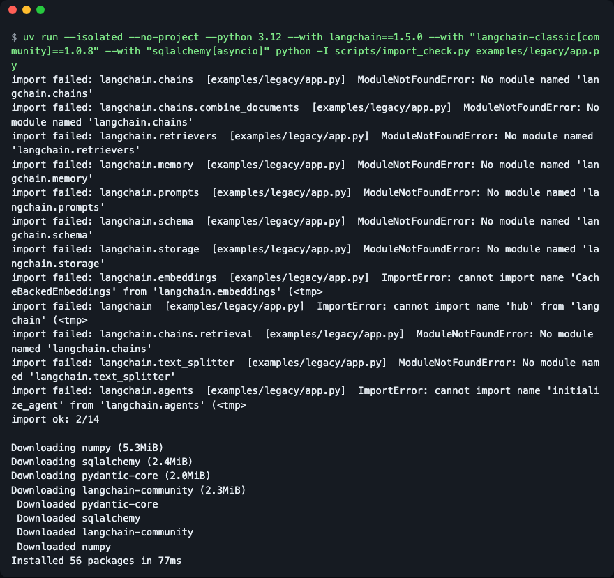
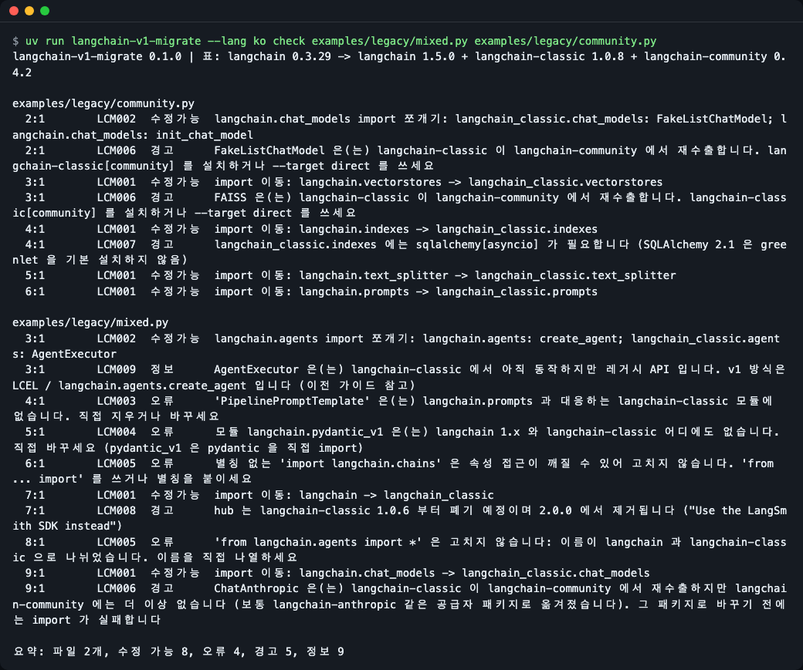
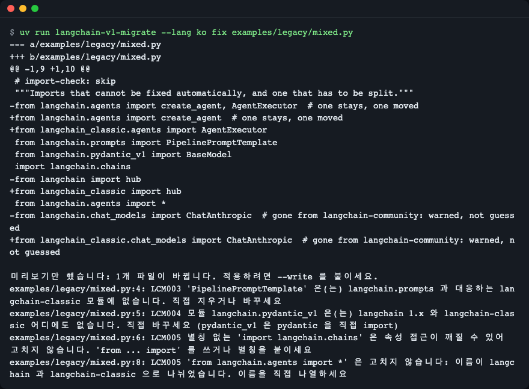
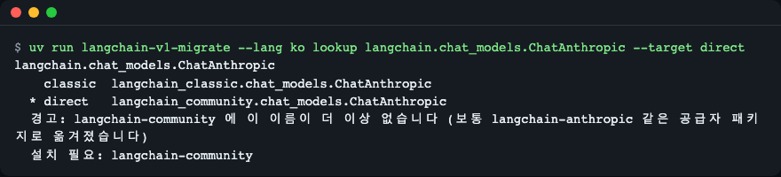
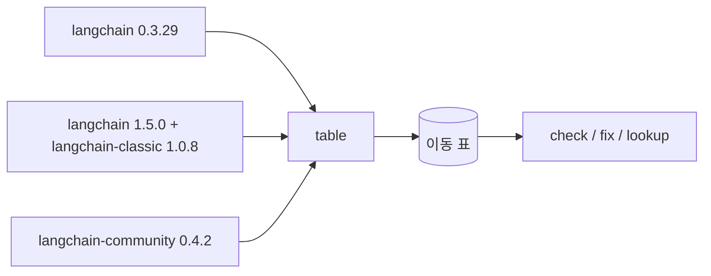

# langchain-v1-migrate

[English](README.md) | **한국어**

LangChain 1.x 로 올린 뒤 나오는 `ModuleNotFoundError: No module named 'langchain.chains'` 를 고칩니다. 옛 `langchain.*` import 를 `langchain_classic`(또는 그 이름을 실제로 정의한 패키지)으로 바꾸고, 빠진 의존성을 더하며, 자동으로 못 고치는 것은 줄 번호와 함께 알려 줍니다. 이동 표는 손으로 쓴 것이 아니라 실제 0.3 과 1.x 패키지에서 계산한 값입니다. 비공식 도구이며 네트워크나 모델 호출이 없습니다.


*고치기 전: 0.x 예제 파일이 langchain 1.5.0 에서 첫 import 에서 멈춥니다.*

## 이런 분께
- `langchain` 을 올렸더니 예전 RAG·챗봇 코드가 import 되지 않는 분
- LangChain 0.x 로 쓴 노트북이나 블로그·강의 예제를 다시 돌리고 싶은 분
- 0.x import 경로가 남아 있으면 CI 가 실패하게 하고 싶은 유지보수자(`check` 가 종료 코드 1)

## 설치

```bash
curl -LsSf https://astral.sh/uv/install.sh | sh   # uv 설치 (Python 3.10 이상 필요)
uv tool install git+https://github.com/LeeGyeongPil/langchain-v1-migrate
```

설치 없이 한 번만 실행하려면: `uvx --from git+https://github.com/LeeGyeongPil/langchain-v1-migrate langchain-v1-migrate check .`

최소 리눅스 이미지에서는 먼저 `curl` 과 `git` 이 필요합니다(예: `apt-get install -y curl git`).

## 빠르게 시작하기

프로젝트 폴더에서 세 단계를 실행합니다. `check` 와 `fix` 미리보기는 아무것도 바꾸지 않습니다.

```bash
langchain-v1-migrate check .          # 1. 무엇이 바뀔까? (있으면 종료 코드 1)
langchain-v1-migrate fix .            # 2. diff 만 미리 보기, 파일은 그대로
langchain-v1-migrate fix . --write    # 3. 실제로 적용
```

아래 예시는 이 저장소의 예제 파일(`examples/legacy/`)을 씁니다.


*`check` 는 발견한 것마다 한 줄을 냅니다: 줄 번호, 코드(`LCM001`...), 심각도, 메시지. 마지막 줄이 개수 요약입니다.*

심각도: `수정가능` 은 `fix --write` 가 고칩니다. `오류` 는 직접 고쳐야 합니다. `경고` 는 읽어 볼 만한 것, `정보` 는 힌트입니다(코드는 돌지만 옛 API 라는 뜻). `--format json` 의 심각도는 언제나 `error`·`warning`·`info` 이고, 수정 가능 여부는 별도의 불리언 `fixable` 입니다. 그래서 요약의 `fixable` 개수는 다른 개수와 겹칩니다.

## 사용법

| 명령 | 하는 일 | 예 |
|---|---|---|
| `check [PATH...]` | 무엇을 고칠지 보고만 합니다. 종료 코드 0 할 일 없음, 1 고칠 것·오류 있음, 2 사용법 오류 | `langchain-v1-migrate check src notebooks` |
| `fix [PATH...]` | diff 를 출력합니다. `--write` 를 주면 파일을 고칩니다. 종료 코드 0 할 일 없음, 1 미리보기에 바뀔 것이 있거나 `--write` 뒤에도 직접 고칠 오류가 남음, 2 사용법 오류 | `langchain-v1-migrate fix . --write` |
| `lookup NAME` | 0.3 의 모듈·이름이 어디로 갔는지 조회합니다 | `langchain-v1-migrate lookup langchain.chains.LLMChain` |
| `table` | 두 `site-packages` 폴더에서 이동 표를 다시 계산합니다(import 하지 않음) | [이동 표는 어떻게 계산하나](#이동-표는-어떻게-계산하나) 참고 |

`check` 와 `fix` 공통 옵션: `--target classic|direct`, `--exclude GLOB`(여러 번 가능), `--table FILE`, `--lang en|ko`. `check` 는 `--format text|json`, `--strict`(경고도 종료 코드 1)도 받고, `fix` 는 `--no-deps` 를 받습니다.

### 시나리오 1: import 한 줄이 두 곳으로 갈라질 때

langchain 1.x 에서 `create_agent` 는 `langchain.agents` 에 남고 `AgentExecutor` 는 `langchain-classic` 으로 옮겨졌습니다. 단순 찾아 바꾸기는 둘 중 하나를 깨뜨립니다. 이 도구는 이름마다 판단해 줄을 쪼갭니다.


*첫 diff 덩어리가 `from langchain.agents import create_agent, AgentExecutor` 를 쪼개고 뒤의 주석을 보존합니다. diff 뒤의 줄들(stderr 로 출력)은 추측하지 않고 알려 주는 항목입니다(`LCM003`, `LCM004`, `LCM005`).*

### 시나리오 2: 의존성도 함께

`fix` 는 `requirements*.txt`, `pyproject.toml`(PEP 621·Poetry, 주석·따옴표 유지), 노트북의 `%pip install` 줄도 고칩니다. `langchain-classic` 을 더하고, community 에서 재수출된 클래스를 쓰면 `[community]` 를, `langchain_classic.indexes` 를 import 하면 `sqlalchemy[asyncio]` 를 더합니다.

![터미널: requirements.txt 와 pyproject.toml 에 langchain-classic[community] 와 sqlalchemy[asyncio] 를 더하는 diff](docs/images/deps.ko.png)
*의존성 줄은 끝에 덧붙이기만 하고 기존 줄은 건드리지 않습니다. 다시 실행해도 바뀌는 것이 없습니다.*

### 시나리오 3: 이름 하나 조회

```bash
langchain-v1-migrate lookup langchain.chat_models.ChatAnthropic --target direct
```


*`classic` 은 공식 `langchain_classic` 경로, `direct` 는 재수출을 따라 실제 정의 패키지로 가는 경로입니다. 여기서는 `langchain-community` 가 더는 `ChatAnthropic` 을 정의하지 않는다고 경고합니다.*

`--target direct` 로 `fix` 하면 `langchain_classic` 대신 `langchain_core`·`langchain_text_splitters`·`langchain_community` 경로를 써서, 껍데기 패키지에 덜 의존합니다.

### 노트북

`.ipynb` 는 셀 단위로 읽습니다. IPython 줄(`%magic`, `!shell`, `df?`)은 그대로 두고, `%%` 셀은 건너뛰며(`LCM010`), 바뀐 셀만 다시 쓰고, 노트북의 들여쓰기와 끝 줄바꿈도 유지합니다. `%pip install` 줄 끝에는 ` langchain-classic` 을 덧붙입니다. 줄에 `&&`, `;`, `|`, `#`, 역슬래시가 있으면 건드리지 않고 알려 줍니다.

### 코드 표

| 코드 | 심각도 | 뜻 | `fix` 가 고치나 |
|---|---|---|---|
| LCM001 | info, 수정가능 | 모듈이 `langchain_classic`(또는 `--target direct` 패키지)으로 이동 | 예 |
| LCM002 | info, 수정가능 | import 한 줄이 `langchain` 과 `langchain_classic` 으로 갈라짐 | 예 |
| LCM003 | error | 1.x 에도 classic 에도 없는 이름 | 아니오, 직접 |
| LCM004 | error | 모듈 자체가 없음(예: `langchain.pydantic_v1`) | 아니오, 직접 |
| LCM005 | error | 별칭 없는 `import langchain.chains`, 또는 `import *` | 아니오, 직접 |
| LCM006 | warning | `langchain-community` 에서 재수출된 이름(extra 필요), 또는 거기에도 더는 없음 | 아니오 |
| LCM007 | warning | `sqlalchemy[asyncio]` 가 필요한 모듈 | 의존성 추가 |
| LCM008 | warning | `hub` 는 폐기 예정, classic 2.0.0 에서 제거 계획 | 경로만 |
| LCM009 | info | classic 으로 동작하지만 옛 API | 아니오 |
| LCM010 | warning | `%%` 셀 건너뜀 | 아니오 |
| LCM011 | error | 파일을 파싱할 수 없음 | 아니오 |
| LCM012 | warning | `langchain==0.3.x` 고정 또는 낮은 `requires-python` | 아니오 |
| LCM013 | warning, 수정가능 | 더할 의존성 또는 `%pip` 줄 | 예 |

`--format json` 의 코드·키·경로는 언어와 무관하고 `message` 만 번역됩니다.

## 설정

설정 파일은 없고 옵션은 명령줄로 줍니다.

| 설정 | 기본값 | 비고 |
|---|---|---|
| `--target` | `classic` | `direct` 는 재수출을 따라 `langchain_core`·`langchain_text_splitters`·`langchain_community` 로 직행 |
| `--lang`, `LANGCHAIN_V1_MIGRATE_LANG` | `LC_ALL`/`LC_MESSAGES`/`LANG` | `en` 또는 `ko`. 우선순위는 `--lang`, 환경 변수, 로캘 순(`ko` 로 시작하면 한국어, 그 밖은 영어) |
| `--exclude GLOB` | 없음 | 폴더를 훑을 때 건너뜀, 여러 번 가능 |

폴더를 훑을 때 `.git`, `.hg`, `.venv`, `venv`, `node_modules`, `__pycache__`, `build`, `dist`, `.tox`, `.ipynb_checkpoints`, `*.egg-info`, 이름과 상관없는 가상환경(`pyvenv.cfg` 가 있는 폴더), `site-packages`/`dist-packages` 폴더도 기본으로 건너뜁니다.
| `--table FILE` | 내장 표 | `table` 로 직접 만든 표 사용 |

모델 호출이 없으므로 목(mock) 모드도 API 키도 없습니다.

### 언어

출력은 영어와 한국어를 지원합니다. 플래그로 바꿉니다.

```bash
langchain-v1-migrate --lang ko check examples/legacy/community.py
```

### CI 에서 쓰기

```yaml
- uses: astral-sh/setup-uv@v7
- run: uvx --from git+https://github.com/LeeGyeongPil/langchain-v1-migrate langchain-v1-migrate check . --strict
```

0.x 경로나 경고가 남아 있으면 종료 코드 1 로 작업이 실패합니다.

## 이동 표는 어떻게 계산하나

옛 경로와 새 경로의 대응은 손으로 쓴 목록이 아닙니다. `table` 이 설치된 패키지의 소스를 `ast` 로 읽어(import 하지 않음) 비교합니다.



- 0.3.29 의 모듈을 하나씩 분류합니다: classic 으로 이동, 일부만 유지(일부 이름만 이동), 사라짐. 동봉 표는 이동 1,313개, 일부 유지 7개(300 이름 이동), 사라짐 9개입니다.
- 재수출 세 종류(최상위 `from x import Name`, 지연 표 `{"FAISS": "langchain_community.vectorstores"}`, 모듈 `__getattr__`)를 따라가, 각 이름이 실제로 어디에 정의됐는지 압니다.
- classic 이 `langchain-community` 에서 재수출하지만 거기에 이름이 더는 없으면 죽은 이름(133개, 예: `ChatAnthropic`)으로 표시해 `LCM006` 으로 알립니다. 정적 판정이라 일부는 오탐일 수 있어 오류가 아닌 경고입니다.
- 클론에서 `uv run python scripts/build_table.py --computed-on 2026-11-18`(네트워크 필요)로 임시 환경에서 표를 다시 만들 수 있고, 결과는 동봉 파일과 바이트까지 같습니다.

내 환경으로 다시 계산하려면: `langchain-v1-migrate table --from-site OLD/site-packages --to-site NEW/site-packages --community-site NEW/site-packages -o my-table.json.gz` 후 `--table my-table.json.gz` 를 줍니다.

## 언제 쓰나

- 잘 맞는 경우: LangChain 0.x 용으로 쓴 프로젝트·노트북·예제를 공식 `langchain-classic` 경로로 1.x 에서 돌리고, 남은 일의 목록을 받고 싶을 때.
- 하지 않는 일: 체인을 LCEL 이나 `create_agent` 로 다시 쓰기, 공급자 패키지(`langchain-openai` 등)로 이름 옮기기, 잠금 파일·`setup.py` 수정.
- 다른 선택지: 수동 이전은 공식 이전 가이드([docs.langchain.com](https://docs.langchain.com/oss/python/migrate/langchain-v1)). `langchain-cli migrate`([PyPI](https://pypi.org/project/langchain-cli/))는 0.3 이전용이고, 2026-11-18 에 시도했을 때 Grit 바이너리를 내려받지 못했습니다. 쓰기 전에 현재 상태를 확인하세요.

## 자주 겪는 문제

| 증상 | 원인 | 해결 |
|---|---|---|
| `fix --write` 직후에도 `check` 가 종료 코드 1 | 경고나 오류가 남음(`LCM003`~`LCM005`) | 그 줄을 직접 고치세요. `check` 가 0 이면 다 끝난 것입니다 |
| 고친 뒤 `ChatAnthropic` 에서 `ImportError` | 이름이 공급자 패키지로 옮겨짐 | `langchain-anthropic` 을 설치해 거기서 import(`LCM006` 참고) |
| `greenlet` / `sqlalchemy.ext.asyncio` 오류 | SQLAlchemy 2.1 은 `greenlet` 을 기본 설치하지 않음 | `sqlalchemy[asyncio]` 설치(`fix` 가 더해 줍니다) |
| `%pip` 줄이 안 바뀜 | 줄에 `&&`, `;`, `|`, `#`, `\` 가 있음 | `langchain-classic` 을 직접 추가(`LCM013`) |
| requirements 파일이 수정되지 않음 | `--hash` 고정 파일 | 패키지를 직접 더하고 파일을 다시 컴파일(`LCM013`) |

## 개발·기여

```bash
uv sync
uv run pytest -q
```

테스트는 오프라인이고 1초 안에 끝납니다. 별도 CI 작업이 이전된 예제가 langchain 1.5.0 에서 실제로 import 되는지 확인합니다(`scripts/import_check.py`). 버그와 제안은 이슈로 남겨 주세요. 변경 기록은 [CHANGELOG.md](CHANGELOG.md).

## 라이선스

MIT. [LICENSE](LICENSE)와 [NOTICE](NOTICE)를 보세요. 비공식 도구이며 LangChain 과 관련이 없습니다. 이동 표는 MIT 라이선스 패키지의 구조에서 유도했고 소스는 복사하지 않았습니다.
