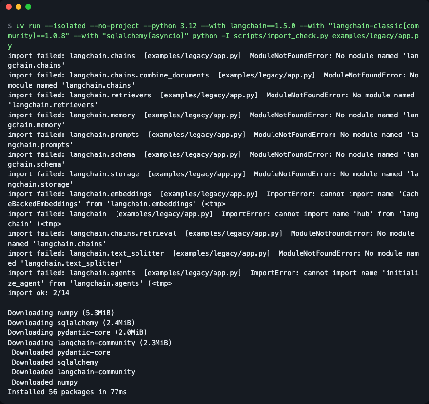
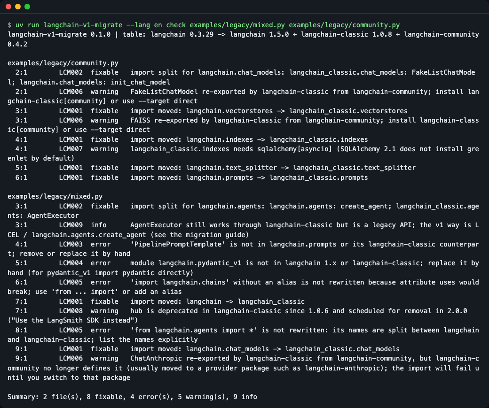
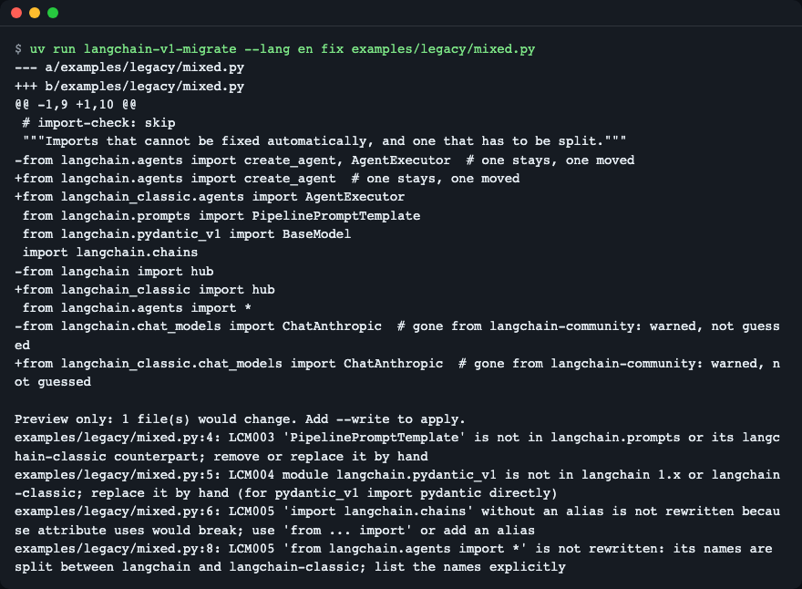
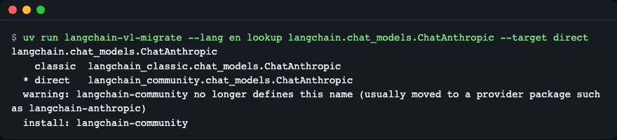
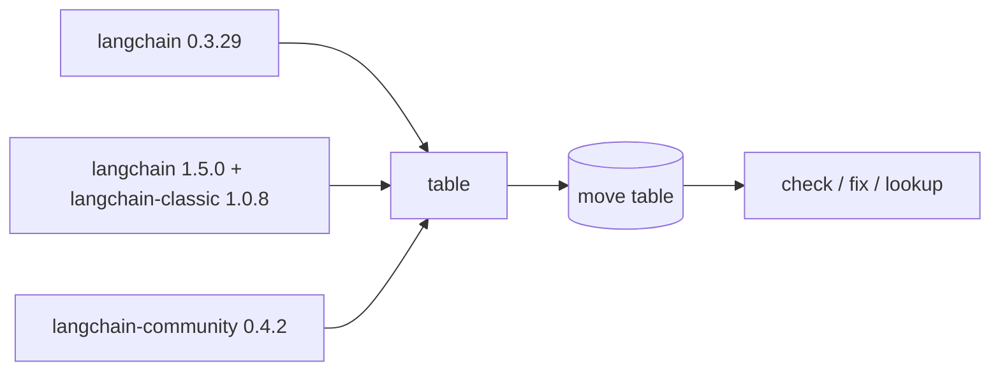

# langchain-v1-migrate

**English** | [한국어](README.ko.md)

Fixes `ModuleNotFoundError: No module named 'langchain.chains'` after you upgrade to LangChain 1.x. It rewrites old `langchain.*` imports to `langchain_classic` (or straight to the package that now defines the name), adds the missing dependencies, and reports what it cannot fix, with line numbers. The move table is computed from the real 0.3 and 1.x packages, not hand-written. Unofficial; no network or model calls.


*Before: the 0.x example file stops at its first import on langchain 1.5.0.*

## Who it is for
- You upgraded `langchain` and old RAG or chatbot code no longer imports.
- You have notebooks or blog/course examples written for LangChain 0.x and want them to run again.
- You maintain a repository and want CI to fail while any 0.x import path is left (`check` exits 1).

## Install

```bash
curl -LsSf https://astral.sh/uv/install.sh | sh   # installs uv (needs Python 3.10+)
uv tool install git+https://github.com/LeeGyeongPil/langchain-v1-migrate
```

Or run it once without installing: `uvx --from git+https://github.com/LeeGyeongPil/langchain-v1-migrate langchain-v1-migrate check .`

On a minimal Linux image you need `curl` and `git` first (for example `apt-get install -y curl git`).

## Quick start

Run the three steps in your project. `check` and the `fix` preview change nothing.

```bash
langchain-v1-migrate check .          # 1. what would change? (exit 1 if anything)
langchain-v1-migrate fix .            # 2. preview the diff, files untouched
langchain-v1-migrate fix . --write    # 3. apply it
```

The examples below use the sample files in this repository (`examples/legacy/`).


*`check` prints one row per finding: line, code (`LCM001`...), severity, message. The summary line gives the counts.*

Severity: `fixable` means `fix --write` will change it, `error` needs a manual edit, `warning` is worth reading, `info` is a hint (the code still runs, but the API is legacy). In `--format json` the severity is always `error`, `warning` or `info`, and fixability is the separate boolean `fixable`; so the summary's `fixable` count overlaps the other counts.

## Usage

| Command | What it does | Example |
|---|---|---|
| `check [PATH...]` | Reports findings, changes nothing. Exit 0 nothing to do, 1 fixable items or errors, 2 usage error | `langchain-v1-migrate check src notebooks` |
| `fix [PATH...]` | Prints a diff. With `--write` it edits the files. Exit 0 nothing left to do, 1 if the preview would change something or manual errors remain after `--write`, 2 usage error | `langchain-v1-migrate fix . --write` |
| `lookup NAME` | Shows where one 0.3 module or name went | `langchain-v1-migrate lookup langchain.chains.LLMChain` |
| `table` | Recomputes the move table from two `site-packages` folders (imports nothing) | see [How the move table is computed](#how-the-move-table-is-computed) |

Options shared by `check` and `fix`: `--target classic|direct`, `--exclude GLOB` (repeatable), `--table FILE`, `--lang en|ko`. `check` also takes `--format text|json` and `--strict` (warnings also give exit 1). `fix` also takes `--no-deps`.

### Scenario 1: one import line, two destinations

In langchain 1.x, `create_agent` stays in `langchain.agents` but `AgentExecutor` moved to `langchain-classic`. A plain search and replace breaks one of them. The tool decides per name and splits the line:


*The first diff hunk splits `from langchain.agents import create_agent, AgentExecutor` and keeps the trailing comment. The lines after the diff (printed to stderr) are findings it will not guess (`LCM003`, `LCM004`, `LCM005`).*

### Scenario 2: dependencies come along

`fix` also edits `requirements*.txt`, `pyproject.toml` (PEP 621 and Poetry, comments and quoting kept) and `%pip install` lines in notebooks. It adds `langchain-classic`, with `[community]` when a re-exported community class is used, and `sqlalchemy[asyncio]` when `langchain_classic.indexes` is imported.

![Terminal: diff that adds langchain-classic[community] and sqlalchemy[asyncio] to requirements.txt and pyproject.toml](docs/images/deps.png)
*Dependency lines are only appended; existing lines are untouched. Running again changes nothing.*

### Scenario 3: look up one name

```bash
langchain-v1-migrate lookup langchain.chat_models.ChatAnthropic --target direct
```


*`classic` is the official `langchain_classic` path; `direct` follows the re-export to the package that defines it. Here the tool warns that `langchain-community` no longer defines `ChatAnthropic`.*

`--target direct` makes `fix` write `langchain_core`, `langchain_text_splitters` or `langchain_community` paths instead of `langchain_classic`, so you depend on fewer shims.

### Notebooks

`.ipynb` files are read cell by cell. IPython lines (`%magic`, `!shell`, `df?`) are kept as they are, `%%` cells are skipped (`LCM010`), only changed cells are rewritten, and the notebook's indentation and trailing newline are kept. A `%pip install` line gets ` langchain-classic` appended; if the line contains `&&`, `;`, `|`, `#` or a backslash it is left alone and reported.

### Findings reference

| Code | Severity | Meaning | Fixed by `fix`? |
|---|---|---|---|
| LCM001 | info, fixable | module moved to `langchain_classic` (or `--target direct` package) | yes |
| LCM002 | info, fixable | one import splits across `langchain` and `langchain_classic` | yes |
| LCM003 | error | name exists in neither 1.x nor classic | no, by hand |
| LCM004 | error | whole module gone (for example `langchain.pydantic_v1`) | no, by hand |
| LCM005 | error | `import langchain.chains` without alias, or `import *` | no, by hand |
| LCM006 | warning | name re-exported from `langchain-community` (needs the extra), or no longer defined there | no |
| LCM007 | warning | module needs `sqlalchemy[asyncio]` | dependency added |
| LCM008 | warning | `hub` is deprecated, removal planned for classic 2.0.0 | path only |
| LCM009 | info | still works via classic but is a legacy API | no |
| LCM010 | warning | `%%` cell skipped | no |
| LCM011 | error | file cannot be parsed | no |
| LCM012 | warning | `langchain==0.3.x` pin or old `requires-python` | no |
| LCM013 | warning, fixable | dependency or `%pip` line to add | yes |

The code, keys and paths in `--format json` do not depend on the language; only `message` is translated.

## Configuration

There is no config file. Options go on the command line.

| Setting | Default | Notes |
|---|---|---|
| `--target` | `classic` | `direct` follows re-exports to `langchain_core`, `langchain_text_splitters`, `langchain_community` |
| `--lang`, `LANGCHAIN_V1_MIGRATE_LANG` | from `LC_ALL`/`LC_MESSAGES`/`LANG` | `en` or `ko`; priority is `--lang`, then the variable, then the locale (a locale starting with `ko` gives Korean, anything else English) |
| `--exclude GLOB` | none | skip folders while walking, repeatable |

By default the walk also skips `.git`, `.hg`, `.venv`, `venv`, `node_modules`, `__pycache__`, `build`, `dist`, `.tox`, `.ipynb_checkpoints`, `*.egg-info`, any virtual environment (a folder with `pyvenv.cfg`) and `site-packages`/`dist-packages` folders.
| `--table FILE` | bundled table | use a table you computed with `table` |

The tool makes no model calls, so there is no mock mode and no API key.

### Language

Output is available in English and Korean. Switch with the flag:

```bash
langchain-v1-migrate --lang ko check examples/legacy/community.py
```

The Korean screenshots are in [README.ko.md](README.ko.md).

### Use in CI

```yaml
- uses: astral-sh/setup-uv@v7
- run: uvx --from git+https://github.com/LeeGyeongPil/langchain-v1-migrate langchain-v1-migrate check . --strict
```

Exit code 1 fails the job while any 0.x path or warning is left.

## How the move table is computed

The mapping from old to new paths is not a hand-written list. `table` reads the source of the installed packages with `ast` (it never imports them) and compares them:



- Each module of 0.3.29 is classified: moved to classic, partly kept (some names moved), or gone. The bundled table has 1,313 moved modules, 7 partly kept (300 names moved) and 9 gone.
- It follows three kinds of re-export (top-level `from x import Name`, lazy `{"FAISS": "langchain_community.vectorstores"}` tables, module `__getattr__`), so it knows where each name is really defined.
- Where classic re-exports from `langchain-community` and the name no longer exists there, it is marked dead (133 names, for example `ChatAnthropic`) and reported as `LCM006`. This is a static check, so a few could be false alarms; it is a warning, not an error.
- From a clone, `uv run python scripts/build_table.py --computed-on 2026-11-18` (needs network) rebuilds the table in temporary environments; the result is byte-identical to the bundled file.

To recompute against your own environment: `langchain-v1-migrate table --from-site OLD/site-packages --to-site NEW/site-packages --community-site NEW/site-packages -o my-table.json.gz`, then pass `--table my-table.json.gz`.

## When to use it

- Good fit: a project, notebook or example set written for LangChain 0.x that you want to run on 1.x with the official `langchain-classic` paths, and you want a report of what is left.
- It does not: rewrite chains to LCEL or `create_agent`, move names to provider packages (such as `langchain-openai`), or edit lock files or `setup.py`.
- Other options: the official migration guide for manual steps ([docs.langchain.com](https://docs.langchain.com/oss/python/migrate/langchain-v1)); `langchain-cli migrate` ([PyPI](https://pypi.org/project/langchain-cli/)) targets the 0.3 move, and when I tried it on 2026-11-18 it could not download its Grit binary. Check their current state before relying on this note.

## Troubleshooting

| Symptom | Cause | Fix |
|---|---|---|
| `check` exits 1 right after `fix --write` | warnings or errors remain (`LCM003`-`LCM005`) | edit those lines by hand; `check` exit 0 means none left |
| `ImportError` for `ChatAnthropic` after fixing | the name moved to a provider package | install and import from `langchain-anthropic` (see `LCM006`) |
| `greenlet` / `sqlalchemy.ext.asyncio` error | SQLAlchemy 2.1 does not install `greenlet` by default | install `sqlalchemy[asyncio]` (`fix` adds it) |
| a `%pip` line was not changed | the line has `&&`, `;`, `|`, `#` or `\` | add `langchain-classic` by hand (`LCM013`) |
| a requirements file was not edited | it uses `--hash` pins | add the package by hand and re-compile the file (`LCM013`) |

## Development

```bash
uv sync
uv run pytest -q
```

Tests are offline and take under a second. A separate CI job checks that the migrated examples really import on langchain 1.5.0 (`scripts/import_check.py`). Report bugs and ideas as issues. Changes are listed in [CHANGELOG.md](CHANGELOG.md).

## License

MIT. See [LICENSE](LICENSE) and [NOTICE](NOTICE). This is an unofficial tool and is not affiliated with LangChain. The move table is derived from the package structure of MIT-licensed packages; no source was copied.
